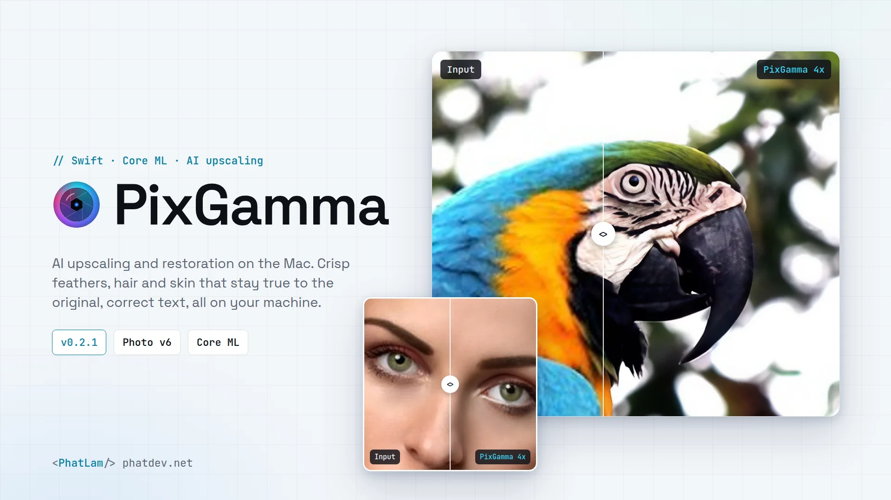
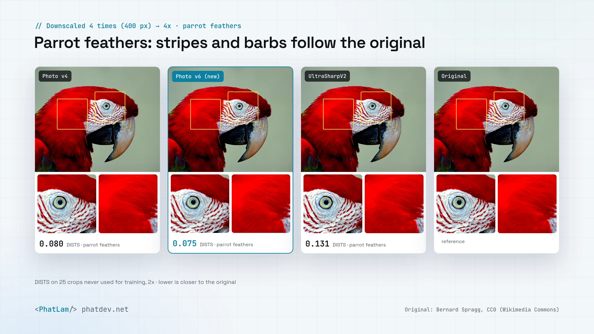
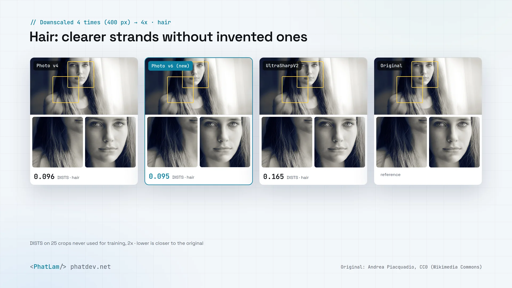
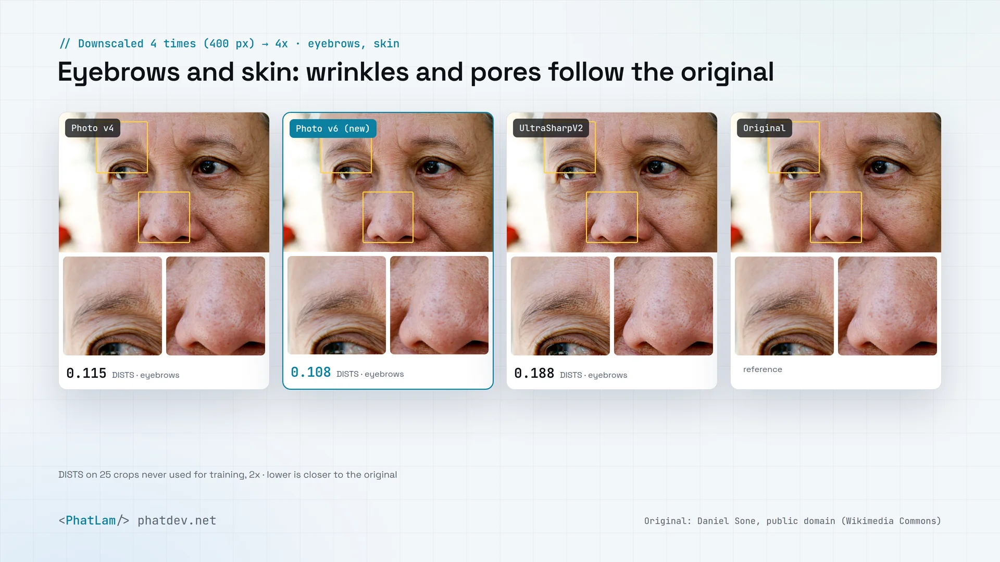
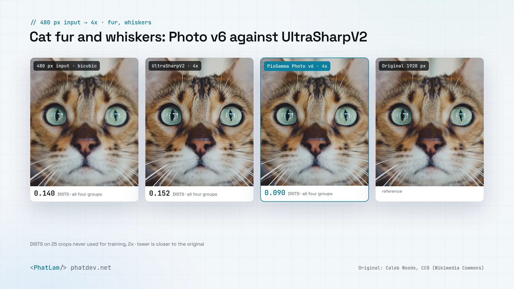
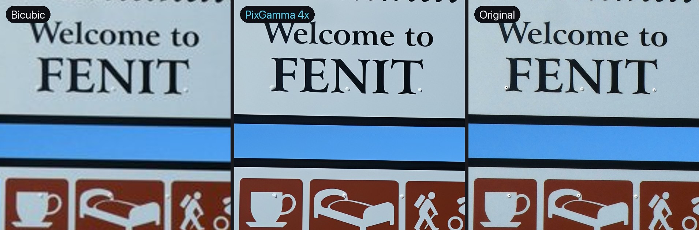

<p align="center">
  
</p>

<h1 align="center">PixGamma</h1>

<p align="center">
  AI image upscaling and restoration for the Mac. Runs fully on-device on the Apple Silicon GPU.<br>
  Built for people who shoot and review laptops: real keycap legends, real texture, real colour.
</p>

<p align="center">
  
  
  
  
  
</p>

<p align="center">
  <a href="README.md">Tiếng Việt</a> · <b>English</b> · <a href="CHANGELOG.md">Changelog (Vietnamese)</a> · <a href="../../releases/latest">Download latest</a>
</p>

<p align="center">
  <picture>
    <source media="(prefers-color-scheme: dark)" srcset="docs/brand/hero-en-dark.webp">
    
  </picture>
</p>

---

## Overview

PixGamma takes a small, soft or compressed image and returns a 2x to 16x larger version with detail restored. It ships as a macOS app, a `pixgamma` CLI for batch work and a local HTTP API for publishing pipelines.

PixGamma is the new name of **Pixora** (up to 0.2.1): old installs update to PixGamma on their own, and the `pixora` command and `PIXORA_*` variables keep working.

Design principles:

- **Images never leave the Mac.** Everything runs in Core ML on the Apple Silicon GPU. No account, no server, no uploads.
- **No invented text.** Keycap legends, labels and banners are detected (Vietnamese included) and rebuilt by a dedicated text model. Text too small to rebuild correctly is kept faithful instead of being redrawn as different letters.
- **Your photo stays your photo.** Colour, tone and facial identity are preserved; generated detail always has a strength control.

## Install

1. Open [Releases](../../releases/latest) and download `PixGamma-<version>.dmg`.
2. Open the DMG and drag **PixGamma** onto **Applications**.
3. First launch: right-click PixGamma in Applications → **Open** → **Open**.
   The app is ad-hoc signed and not notarized, so macOS asks once.
4. For the `pixgamma` command in Terminal, double-click **Cài lệnh pixgamma (CLI).command** in the DMG.

If macOS says the app is "damaged" or refuses to open it, run once:

```bash
xattr -dr com.apple.quarantine /Applications/PixGamma.app
```

### Automatic updates

PixGamma checks for a new version once a day; check now from **PixGamma → Kiểm tra cập nhật…** (Check for updates). When one is available the app shows the release notes, downloads the DMG, verifies its SHA-256, replaces itself and relaunches.

The PixGamma repository is public, so **no GitHub token is needed**. Without one, GitHub allows 60 requests an hour per IP address, plenty for update checks. If the app says the limit is used up (for example many Macs behind one network), you can add a token to get 5,000 an hour:

1. Open the [token page](https://github.com/settings/personal-access-tokens/new) (fine-grained token).
2. **Repository access**: Public repositories (read-only); no extra permissions.
3. In the update dialog showing the error, click **Dùng token GitHub…** (Use a GitHub token) and paste it. It is stored in this Mac's Keychain.

From Terminal: `pixgamma update` (check), `pixgamma update --install` (install; quit the app first), `pixgamma update --token <token>` (save an optional token). `PIXGAMMA_GITHUB_TOKEN` overrides the Keychain for scripts.

### Recover mode (optional)

Recover uses diffusion to redraw skin, pores, hair strands and fur. Its models are about 2.7 GB, so they ship separately:

1. Download `PixGamma-Recover-<version>-1.zip` and `-2.zip` from Releases into **Downloads**.
2. In the DMG, double-click **Cài model Recover.command**. The models go to `~/Library/Application Support/PixGamma/Models/Recover`.
3. Reopen PixGamma; the **Recover** card appears.

### Requirements

| | Minimum | Recommended |
|---|---|---|
| macOS | 14 Sonoma | 15 or later |
| Chip | Apple Silicon M1 | M2/M3/M4 Pro, Max or Ultra |
| RAM | 8 GB (regular upscaling) | 32 GB or more for Recover |
| Disk | 1 GB | 4 GB with Recover |

### Uninstall

Delete `/Applications/PixGamma.app` and `~/Library/Application Support/PixGamma`. If you installed the CLI, also delete `pixgamma` from `/opt/homebrew/bin`, `/usr/local/bin` or `~/.local/bin`.

## Examples

Originals were downscaled 4 times (400 to 480 px) and upscaled back 4x. Each figure puts PixGamma Photo v6 next to Photo v4, UltraSharpV2 and the original; the yellow boxes are the crops shown below, and the DISTS numbers come from the fine-detail benchmark (lower is closer to the original).

<picture>
  <source media="(prefers-color-scheme: dark)" srcset="docs/samples/compare-macaw-v6-en-dark.webp">
  
</picture>

<picture>
  <source media="(prefers-color-scheme: dark)" srcset="docs/samples/compare-hair-v6-en-dark.webp">
  
</picture>

<picture>
  <source media="(prefers-color-scheme: dark)" srcset="docs/samples/compare-skin-v6-en-dark.webp">
  
</picture>

<picture>
  <source media="(prefers-color-scheme: dark)" srcset="docs/samples/compare-fur-v6-en-dark.webp">
  
</picture>

| Welcome sign in Fenit, Ireland (text protection; bicubic, PixGamma 4x through the app, original) |
|---|
|  |

Sample sources: [docs/samples/CREDITS.md](docs/samples/CREDITS.md) (CC0 and public domain).

## Features

| Area | Details |
|---|---|
| **AI modes** | **Auto** (measures noise, sharpness, JPEG blocking and faces, then picks a model); **Standard** (PixGamma Photo v6, our own DAT2 fine-tune of UltraSharpV2, trained further on feather, hair and skin close-ups for crisper strands, brows and pores while staying close to the original; text regions use Photo v1, and SPAN trained on compressed, blurred, noisy real photos; true materials, no invented texture); **High Fidelity** (faithful, Detail slider); **Art & CGI**; **Low Resolution** (continuous denoise); **Recover** (diffusion pixel regeneration; describes the photo by itself, e.g. "parrot, detailed feathers"; picks resemblance 85 for animals, hair and skin; a safety lock keeps shapes on photos with text, maps or products). |
| **Text** | Apple Vision finds and reads text, including Vietnamese with full diacritics. Text regions are rebuilt by a **dedicated text model** (RealPLKSR fine-tuned on synthetic Vietnamese/English text), averaged over 8 flips/rotations for straight strokes. Line size is measured from the pixels: lines too small (capitals under ~4 px) stay faithful. |
| **Faces** | Realistic (CodeFormer, identity slider) or Creative (GFPGAN). Recover adds dedicated eye and eyebrow passes. |
| **Size** | 1–16x scale, or target width/height. Uses the smallest 2x/4x base that suffices, stacks passes beyond 4x. Context-padded tiles, no seams. |
| **Adjustments** | Denoise, sharpen, JPEG artefact removal, dehalo, local contrast and vibrance, natural grain. Source colour is restored after upscaling. Transparency is kept. |
| **Export** | PNG, JPEG, TIFF, HEIC or source format. Keeps EXIF/GPS/IPTC, writes DPI, prefix/suffix naming, never overwrites the original. |
| **CLI and API** | `pixgamma` for batches (recursive, JSON output). `pixgamma serve` starts a local HTTP API, also switchable from the app. |
| **Speed** | GPU by default. On a Mac Studio M2 Ultra: 800×600 to 4x in about 5–8 s (Standard), to 2x in about 1 s; Recover on a 1536 px image in about 35 s. |

## CLI

```bash
pixgamma upscale photo.jpg --scale 4
```

```bash
pixgamma upscale ~/Pictures/laptop -r -o ~/Pictures/out -m std --scale 2 -f jpg --jq 92 --se
```

```bash
pixgamma upscale portrait.jpg -m rec --cr 75
```

| Flag | Meaning |
|---|---|
| `-m` | `auto`, `std`, `hf`, `art`, `low`, `rec` |
| `--scale`, `--width`, `--height` | Output size |
| `--dn`, `--sh`, `--cm`, `--dh` | Denoise, sharpen, JPEG cleanup, dehalo (0–100) |
| `--dt`, `--tx`, `--lc` | Detail (High Fidelity), grain, local contrast |
| `--fr`, `--frc`, `--frf` | Face recovery, `realistic`/`creative`, identity strength |
| `--cr`, `--rs`, `--prompt` | Recover: Creativity, Resemblance (default by scene), optional prompt (default: automatic description) |
| `--no-text-protect`, `--no-color-fix` | Disable text protection, disable colour restore |
| `-f`, `--jq`, `--res` | Format, JPEG/HEIC quality, DPI |
| `-r`, `-o`, `--se`, `--am` | Recursive, output folder, skip existing, append model to file name |
| `-d` | `gpu` (default), `all`, `ane`, `cpu` |
| `--json`, `-q` | JSON report (includes recognised text), quiet |

See all flags with `pixgamma upscale --help`. Other commands: `pixgamma analyze photo.jpg` (suggested Auto settings), `pixgamma models` (models and file locations).

## API

```bash
pixgamma serve --port 8765
```

```bash
curl --data-binary @photo.jpg "http://127.0.0.1:8765/v1/upscale?mode=std&scale=2&format=jpg" -o photo-2x.jpg
```

Endpoints: `/health`, `/v1/models`, `/v1/analyze`, `/v1/upscale`. `/v1/upscale` parameters: `mode`, `scale` or `width`/`height`, `denoise`, `sharpen`, `compression`, `detail`, `texture`, `contrast`, `dehalo`, `face`, `face_style=realistic|creative`, `face_fidelity`, `creativity`, `resemblance`, `prompt`, `text=0|1`, `color=0|1`, `device=gpu|all|ane|cpu`, `format=png|jpg|tiff|heic`, `quality`. The report is in the `X-PixGamma-Report` header; send `Accept: application/json` for JSON with a base64 image.

## Troubleshooting

| Symptom | Fix |
|---|---|
| macOS won't open it, says "damaged" | Run `xattr -dr com.apple.quarantine /Applications/PixGamma.app`, then reopen |
| `pixgamma: command not found` | Double-click **Cài lệnh pixgamma (CLI).command** in the DMG, open a new Terminal |
| No Recover card | Recover models not installed, see Recover mode |
| Update says GitHub allows 60 checks an hour | Wait until the time shown, or click **Dùng token GitHub…** and paste a token (see [Automatic updates](#automatic-updates)) |
| Update says the saved GitHub token is invalid | Click **Xoá token** (Remove token) in the update dialog, since the public repo needs none, or unset a wrong `PIXGAMMA_GITHUB_TOKEN` |
| First run much slower | Core ML compiles models for this Mac on first use (tens of seconds); later runs are fast |
| Mac slows down during Recover | Recover uses a lot of GPU memory; close other heavy apps (VMs, many browser tabs) |

## Build from source

Requires Xcode 16 or later (Swift 6). Regenerating models also needs [uv](https://docs.astral.sh/uv/) and Python 3.12.

```bash
uv run --python 3.12 --with torch --with coremltools --with numpy --with pillow tools/convert_models.py
```

```bash
uv run --python 3.12 --with torch --with coremltools --with numpy --with pillow --with spandrel python tools/convert_extra.py
```

```bash
PixGamma/scripts/build.sh --install
```

| Script | Purpose |
|---|---|
| `PixGamma/scripts/build.sh` | Builds app and CLI, compiles models, ad-hoc signs → `PixGamma/build/PixGamma.app`. `--install` copies to /Applications and links `pixgamma` |
| `PixGamma/scripts/make_dmg.sh` | Builds the installer `PixGamma-<version>.dmg` and `.dmg.sha256` (required by the updater); `--recover` also builds the two Recover model zips |
| `generative/convert_recover.sh` | Converts Realistic Vision 5.1 + ControlNet Tile to Core ML for Recover |
| `training/` | Synthetic text data, fine-tune configs (traiNNer-redux on the Mac GPU), `eval_text.py` scorer |

If the checkout is in an iCloud-synced folder (such as Desktop), the scripts assemble and sign in a temporary folder to avoid the "detritus not allowed" codesign error.

## Architecture

```
PixGamma (Swift package)
├── PixGammaCore     engine: Core ML tiling, model choice, colour and text protection,
│                  face restoration, Recover (diffusion), Auto analysis, image I/O, HTTP API
├── pixgamma         CLI (swift-argument-parser)
└── PixGammaApp      SwiftUI app
```

## Documentation

- [Changelog (Vietnamese)](CHANGELOG.md)
- [Design and analysis](docs/pixgamma-design.md)
- [Fine-tuning research](docs/finetune-research.md)
- [Model licenses](PixGamma/Models/LICENSES.md)

## Models and credits

- [Real-ESRGAN](https://github.com/xinntao/Real-ESRGAN) (BSD-3-Clause), Xintao Wang et al.
- [4xBHI_dat2_real](https://huggingface.co/Phips/4xBHI_dat2_real) (base of PhotoV1), [2xNomosUni_span_multijpg_ldl](https://openmodeldb.info/models/2x-NomosUni-span-multijpg-ldl) and [4xNomosWebPhoto_RealPLKSR](https://openmodeldb.info/models/4x-NomosWebPhoto-RealPLKSR) (CC-BY-4.0), Philip Hofmann. PhotoV1 (used for text) is a fine-tune of 4xBHI_dat2_real; the text model is a fine-tune of 4xNomosWebPhoto_RealPLKSR.
- [4x-UltraSharpV2](https://huggingface.co/Kim2091/UltraSharpV2) (CC-BY-NC-SA-4.0), Kim2091: base of the Photo model (PixGamma Photo v3, v4, v6). These weights are shared under the same license, for non-commercial use only.
- [GFPGAN](https://github.com/TencentARC/GFPGAN) (Apache-2.0), Tencent ARC
- [CodeFormer](https://github.com/sczhou/CodeFormer) (S-Lab License 1.0, **non-commercial only**), Shangchen Zhou et al.
- Recover: [Realistic Vision V5.1](https://huggingface.co/SG161222/Realistic_Vision_V5.1_noVAE) and [ControlNet 1.1 Tile](https://huggingface.co/lllyasviel/control_v11f1e_sd15_tile) (CreativeML OpenRAIL-M), [sd-vae-ft-mse](https://huggingface.co/stabilityai/sd-vae-ft-mse) (MIT), converted with Apple's [ml-stable-diffusion](https://github.com/apple/ml-stable-diffusion)

## Contributors

| | Role |
|---|---|
| **Steven Lam** ([@PhatLam1108](https://github.com/PhatLam1108)) | Author: planning and product direction, architecture design, choosing, converting and training the AI models, image-quality direction, real-world testing and releases |
| **Claude** ([Anthropic](https://www.anthropic.com/claude)) | Writes the code to Steven Lam's plan and architecture, via [Claude Code](https://claude.com/claude-code) |
| **Gemini** ([Google](https://deepmind.google/models/gemini/)) | UI refinement, via [Antigravity](https://antigravity.google) (Gemini 3.8, Gemini 4 Argon) |
| **Codex** ([OpenAI](https://openai.com/codex)) | Code review, feedback on errors and bugs |

Commits written with Claude carry a `Co-Authored-By: Claude` line.

## License

PixGamma source code: all rights reserved. Free, non-commercial use. Each model keeps its author's license, see [PixGamma/Models/LICENSES.md](PixGamma/Models/LICENSES.md).
