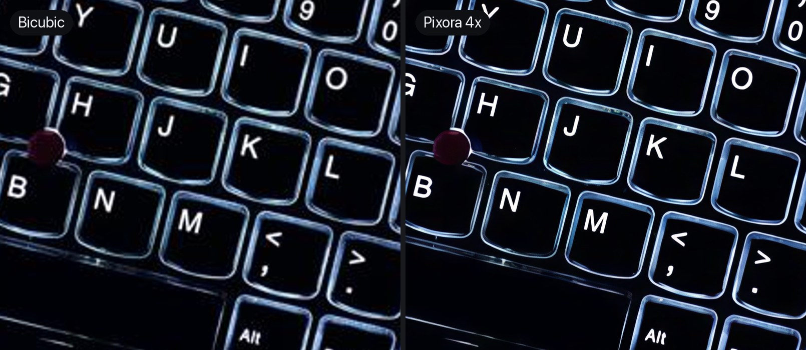
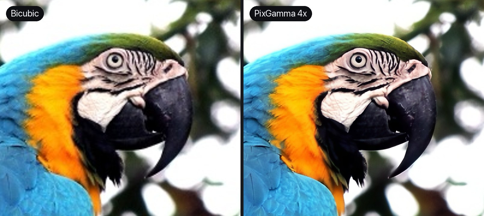
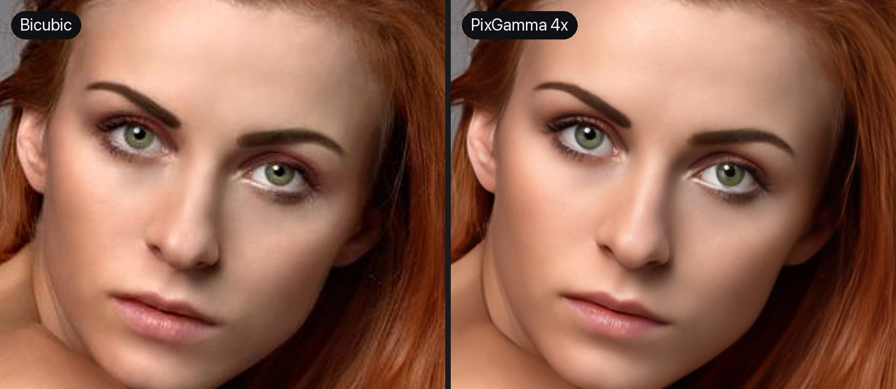

<p align="center">
  
</p>

<h1 align="center">Pixora</h1>

<p align="center">
  Phóng to và phục hồi ảnh bằng AI trên Mac. Chạy hoàn toàn trên máy bằng GPU Apple Silicon.<br>
  Làm cho người chụp và viết review laptop: giữ đúng chữ trên phím, kết cấu thật, màu thật.
</p>

<p align="center">
  
  
  
  
  
</p>

<p align="center">
  <b>Tiếng Việt</b> · <a href="README.en.md">English</a> · <a href="CHANGELOG.md">Nhật ký thay đổi</a> · <a href="../../releases/latest">Tải bản mới nhất</a>
</p>

<p align="center">
  <picture>
    <source media="(prefers-color-scheme: dark)" srcset="docs/brand/hero-vi-dark.webp">
    
  </picture>
</p>

---

## Giới thiệu

Pixora nhận một ảnh nhỏ, mờ hoặc đã nén và trả lại bản lớn hơn 2x đến 16x, có lại chi tiết. Gồm app macOS, lệnh `pixora` để xử lý hàng loạt và HTTP API cục bộ để nối vào quy trình đăng bài.

Ba nguyên tắc thiết kế:

- **Ảnh không rời khỏi máy.** Mọi xử lý chạy bằng Core ML trên GPU Apple Silicon. Không tài khoản, không máy chủ, không gửi ảnh đi đâu.
- **Không bịa chữ.** Chữ trên phím laptop, nhãn, banner được nhận diện riêng (có tiếng Việt) và dựng lại bằng model chữ riêng. Chữ quá nhỏ để dựng lại đúng thì được giữ trung thực, không vẽ thành chữ khác.
- **Giữ ảnh là ảnh của bạn.** Màu, tông và nét mặt gốc được giữ lại; chi tiết sinh thêm luôn có thanh chỉnh độ mạnh.

## Cài đặt

1. Vào trang [Releases](../../releases/latest) và tải `Pixora-<phiên bản>.dmg`.
2. Mở file DMG, kéo **Pixora** vào **Applications**.
3. Lần đầu mở: chuột phải vào Pixora trong Applications → **Open** → **Open**.
   App được ký ad-hoc, chưa qua notarize của Apple, nên macOS hỏi xác nhận một lần.
4. Muốn dùng lệnh `pixora` trong Terminal: trong DMG, bấm đúp **Cài lệnh pixora (CLI).command**.

Nếu macOS báo ứng dụng "bị hỏng" hoặc không cho mở, chạy lệnh sau một lần:

```bash
xattr -dr com.apple.quarantine /Applications/Pixora.app
```

### Tự cập nhật

Pixora tự kiểm tra bản mới mỗi ngày một lần; kiểm tra ngay ở menu **Pixora → Kiểm tra cập nhật…** Khi có bản mới, app hiện ghi chú phát hành, tải file DMG, kiểm tra mã SHA-256, thay app rồi tự mở lại.

Repo Pixora công khai nên **không cần token GitHub**. Không có token, GitHub cho mỗi địa chỉ IP 60 lần gọi mỗi giờ, thừa cho việc kiểm tra cập nhật. Nếu app báo hết lượt (vd nhiều máy chung một mạng), có thể dùng thêm một token để có 5.000 lượt mỗi giờ:

1. Mở [trang tạo token](https://github.com/settings/personal-access-tokens/new) (Fine-grained token).
2. **Repository access**: Public repositories (read-only); không cần thêm quyền nào.
3. Trong hộp thoại cập nhật báo lỗi, bấm **Dùng token GitHub…** rồi dán token. Token được cất trong Keychain của máy.

Từ Terminal: `pixora update` (kiểm tra), `pixora update --install` (cài, cần đóng app trước), `pixora update --token <token>` (lưu token, không bắt buộc). Biến `PIXORA_GITHUB_TOKEN` dùng thay Keychain cho script.

### Chế độ Recover (tùy chọn)

Recover dùng diffusion để vẽ lại da, lỗ chân lông, sợi tóc, lông thú. Bộ model nặng khoảng 2,7 GB nên tách khỏi DMG:

1. Tải `Pixora-Recover-<phiên bản>-1.zip` và `-2.zip` ở trang Releases vào thư mục **Downloads**.
2. Trong DMG, bấm đúp **Cài model Recover.command**. Model được cài vào `~/Library/Application Support/Pixora/Models/Recover`.
3. Mở lại Pixora, thẻ **Recover** sẽ hiện ra.

### Yêu cầu

| | Tối thiểu | Khuyến nghị |
|---|---|---|
| macOS | 14 Sonoma | 15 trở lên |
| Chip | Apple Silicon M1 | M2/M3/M4 Pro, Max hoặc Ultra |
| RAM | 8 GB (các chế độ phóng thường) | 32 GB trở lên cho Recover |
| Ổ trống | 1 GB | 4 GB nếu cài Recover |

### Gỡ cài đặt

Xóa `/Applications/Pixora.app` và thư mục `~/Library/Application Support/Pixora`. Nếu đã cài CLI, xóa thêm file `pixora` trong `/opt/homebrew/bin`, `/usr/local/bin` hoặc `~/.local/bin`.

## Ví dụ

Ảnh vào được thu nhỏ 4 lần rồi nén JPEG để giống ảnh lấy từ web. Bên trái phóng lại bằng bicubic, bên phải là Pixora 4x.

| Bàn phím ThinkPad đèn nền (giữ chữ) |
|---|
|  |

| Vẹt (Standard) |
|---|
|  |

| Chân dung (khuôn mặt Chân thực) |
|---|
|  |

Nguồn ảnh mẫu ở [docs/samples/CREDITS.md](docs/samples/CREDITS.md) (CC0 và public domain).

## Tính năng

| Mảng | Nội dung |
|---|---|
| **Chế độ AI** | **Auto** (tự đo nhiễu, độ nét, khối JPEG, khuôn mặt rồi chọn model); **Standard** (Pixora Photo v1, DAT2 fine-tune riêng, và SPAN huấn luyện trên ảnh chụp thật bị nén, mờ, nhiễu; giữ đúng chất liệu, không vẽ vân giả); **High Fidelity** (trung thực, thanh Detail); **Art & CGI**; **Low Resolution** (khử nhiễu liên tục); **Recover** (tái tạo điểm ảnh bằng diffusion, thanh Creativity và Resemblance). |
| **Chữ** | Apple Vision dò và đọc chữ, có tiếng Việt đủ dấu. Vùng chữ dựng lại bằng **model chữ riêng** (RealPLKSR fine-tune trên chữ Việt/Anh tự sinh), lấy trung bình 8 lượt lật/xoay cho nét thẳng. Đo cỡ từng dòng từ điểm ảnh: dòng quá nhỏ (chữ hoa dưới ~4 px) giữ bản trung thực. |
| **Khuôn mặt** | Chân thực (CodeFormer, có thanh giữ nét mặt gốc) hoặc Sáng tạo (GFPGAN). Recover có thêm lượt riêng cho mắt và lông mày. |
| **Kích thước** | Theo tỉ lệ 1–16x, theo chiều rộng hoặc chiều cao. Chọn mức gốc 2x/4x đủ dùng, chồng lượt khi trên 4x. Chia ô có ngữ cảnh nên không lộ đường ghép. |
| **Tinh chỉnh** | Khử nhiễu, làm nét, khử nén JPEG, khử viền sáng, tương phản cục bộ và độ rực, kết cấu hạt. Giữ màu gốc sau khi phóng. Ảnh nền trong suốt giữ được alpha. |
| **Xuất file** | PNG, JPEG, TIFF, HEIC hoặc giữ định dạng gốc. Giữ EXIF/GPS/IPTC, ghi DPI, đặt tiền tố/hậu tố, không bao giờ ghi đè ảnh gốc. |
| **CLI và API** | `pixora` xử lý hàng loạt, đệ quy thư mục, in JSON. `pixora serve` mở HTTP API cục bộ, bật được ngay trong app. |
| **Tốc độ** | Mặc định chạy GPU. Trên Mac Studio M2 Ultra: ảnh 800×600 lên 4x khoảng 5–8 giây (Standard), lên 2x khoảng 1 giây; Recover ảnh 1536 px khoảng 35 giây. |

## Dùng CLI

```bash
pixora upscale anh.jpg --scale 4
```

```bash
pixora upscale ~/Anh/laptop -r -o ~/Anh/out -m std --scale 2 -f jpg --jq 92 --se
```

```bash
pixora upscale chan-dung.jpg -m rec --cr 75 --rs 40
```

| Cờ | Ý nghĩa |
|---|---|
| `-m` | `auto`, `std`, `hf`, `art`, `low`, `rec` |
| `--scale`, `--width`, `--height` | Kích thước đầu ra |
| `--dn`, `--sh`, `--cm`, `--dh` | Khử nhiễu, làm nét, khử nén JPEG, khử viền sáng (0–100) |
| `--dt`, `--tx`, `--lc` | Detail (High Fidelity), kết cấu hạt, tương phản cục bộ |
| `--fr`, `--frc`, `--frf` | Phục hồi khuôn mặt, kiểu `realistic`/`creative`, mức giữ mặt gốc |
| `--cr`, `--rs`, `--prompt` | Recover: Creativity, Resemblance, prompt tùy chọn |
| `--no-text-protect`, `--no-color-fix` | Tắt giữ chữ, tắt giữ màu gốc |
| `-f`, `--jq`, `--res` | Định dạng, chất lượng JPEG/HEIC, DPI |
| `-r`, `-o`, `--se`, `--am` | Đệ quy, thư mục ra, bỏ qua file đã có, thêm tên model vào tên file |
| `-d` | `gpu` (mặc định), `all`, `ane`, `cpu` |
| `--json`, `-q` | In báo cáo JSON (có chữ đọc được), chạy im lặng |

Xem đủ bằng `pixora upscale --help`. Lệnh khác: `pixora analyze anh.jpg` (in thiết lập Auto đề xuất), `pixora models` (liệt kê model và vị trí file).

## Dùng API

```bash
pixora serve --port 8765
```

```bash
curl --data-binary @anh.jpg "http://127.0.0.1:8765/v1/upscale?mode=std&scale=2&format=jpg" -o anh-2x.jpg
```

Điểm cuối: `/health`, `/v1/models`, `/v1/analyze`, `/v1/upscale`. Tham số của `/v1/upscale`: `mode`, `scale` hoặc `width`/`height`, `denoise`, `sharpen`, `compression`, `detail`, `texture`, `contrast`, `dehalo`, `face`, `face_style=realistic|creative`, `face_fidelity`, `creativity`, `resemblance`, `prompt`, `text=0|1`, `color=0|1`, `device=gpu|all|ane|cpu`, `format=png|jpg|tiff|heic`, `quality`. Báo cáo nằm trong header `X-Pixora-Report`; gửi `Accept: application/json` để nhận JSON kèm ảnh base64.

## Xử lý sự cố

| Hiện tượng | Cách xử lý |
|---|---|
| macOS không cho mở, báo "bị hỏng" | Chạy `xattr -dr com.apple.quarantine /Applications/Pixora.app` rồi mở lại |
| `pixora: command not found` | Bấm đúp **Cài lệnh pixora (CLI).command** trong DMG, mở Terminal mới |
| Không thấy thẻ Recover | Chưa cài model Recover, xem mục Chế độ Recover |
| Cập nhật báo "GitHub giới hạn 60 lần kiểm tra mỗi giờ" | Chờ tới giờ được báo, hoặc bấm **Dùng token GitHub…** và dán một token (xem [Tự cập nhật](#tự-cập-nhật)) |
| Cập nhật báo "Token GitHub đã lưu không hợp lệ" | Bấm **Xoá token** trong hộp thoại cập nhật (repo công khai không cần token), hoặc `PIXORA_GITHUB_TOKEN` đang đặt sai: bỏ biến này |
| Lần chạy đầu chậm hơn hẳn | Core ML compile model cho máy ở lần đầu (vài chục giây), các lần sau nhanh |
| Máy chậm khi chạy Recover | Recover dùng nhiều RAM GPU; đóng app nặng khác (máy ảo, trình duyệt nhiều tab) |

## Tự build từ mã nguồn

Cần Xcode 16 trở lên (Swift 6). Để tạo lại model cần thêm [uv](https://docs.astral.sh/uv/) và Python 3.12.

```bash
uv run --python 3.12 --with torch --with coremltools --with numpy --with pillow tools/convert_models.py
```

```bash
uv run --python 3.12 --with torch --with coremltools --with numpy --with pillow --with spandrel python tools/convert_extra.py
```

```bash
Pixora/scripts/build.sh --install
```

| Script | Tác dụng |
|---|---|
| `Pixora/scripts/build.sh` | Build app và CLI, compile model, ký ad-hoc → `Pixora/build/Pixora.app`. `--install` chép vào /Applications và link `pixora` |
| `Pixora/scripts/make_dmg.sh` | Tạo file cài đặt `Pixora-<phiên bản>.dmg` và `.dmg.sha256` (bắt buộc cho tự cập nhật); `--recover` tạo thêm 2 file zip model Recover |
| `generative/convert_recover.sh` | Chuyển Realistic Vision 5.1 + ControlNet Tile sang Core ML cho Recover |
| `training/` | Sinh dữ liệu chữ, cấu hình fine-tune (traiNNer-redux trên GPU Mac), bộ chấm `eval_text.py` |

Nếu thư mục nằm trong vùng đồng bộ iCloud (ví dụ Desktop), các script tự đóng gói và ký ở thư mục tạm để tránh lỗi ký mã "detritus not allowed".

## Kiến trúc

```
Pixora (Swift package)
├── PixoraCore     engine: chia ô Core ML, chọn model, giữ màu, giữ chữ, phục hồi mặt,
│                  Recover (diffusion), phân tích Auto, đọc/ghi ảnh, HTTP API
├── pixora         CLI (swift-argument-parser)
└── PixoraApp      app SwiftUI
```

| Thư mục | Nội dung |
|---|---|
| `Pixora/Sources/` | Mã nguồn app, CLI và engine |
| `Pixora/Models/` | Model Core ML (không nằm trong git) và [giấy phép model](Pixora/Models/LICENSES.md) |
| `Pixora/scripts/` | Build, cài đặt, đóng gói DMG |
| `tools/`, `generative/` | Chuyển trọng số PyTorch sang Core ML |
| `training/` | Dữ liệu, cấu hình fine-tune, bộ chấm |
| `docs/` | Thiết kế, nghiên cứu, ảnh mẫu, logo |

## Tài liệu

- [Nhật ký thay đổi](CHANGELOG.md)
- [Thiết kế và phân tích](docs/pixora-design.md): phân tích Real-ESRGAN và cách hiện thực từng tính năng
- [Nghiên cứu fine-tune](docs/finetune-research.md): kiến trúc, checkpoint, công cụ, công thức
- [Giấy phép model](Pixora/Models/LICENSES.md)

## Model và ghi công

Pixora dùng các model mã nguồn mở, đã chuyển sang Core ML:

- [Real-ESRGAN](https://github.com/xinntao/Real-ESRGAN) (BSD-3-Clause), Xintao Wang và cộng sự
- [4xBHI_dat2_real](https://huggingface.co/Phips/4xBHI_dat2_real) (gốc của model Photo), [2xNomosUni_span_multijpg_ldl](https://openmodeldb.info/models/2x-NomosUni-span-multijpg-ldl) và [4xNomosWebPhoto_RealPLKSR](https://openmodeldb.info/models/4x-NomosWebPhoto-RealPLKSR) (CC-BY-4.0), Philip Hofmann. Model Photo (Pixora Photo v1) là bản fine-tune của 4xBHI_dat2_real, model chữ là bản fine-tune của 4xNomosWebPhoto_RealPLKSR.
- [GFPGAN](https://github.com/TencentARC/GFPGAN) (Apache-2.0), Tencent ARC
- [CodeFormer](https://github.com/sczhou/CodeFormer) (S-Lab License 1.0, **chỉ phi thương mại**), Shangchen Zhou và cộng sự
- Recover: [Realistic Vision V5.1](https://huggingface.co/SG161222/Realistic_Vision_V5.1_noVAE) và [ControlNet 1.1 Tile](https://huggingface.co/lllyasviel/control_v11f1e_sd15_tile) (CreativeML OpenRAIL-M), [sd-vae-ft-mse](https://huggingface.co/stabilityai/sd-vae-ft-mse) (MIT), chuyển bằng [ml-stable-diffusion](https://github.com/apple/ml-stable-diffusion) của Apple

## Người đóng góp

| | Vai trò |
|---|---|
| **Steven Lam** ([@PhatLam1108](https://github.com/PhatLam1108)) | Chủ sản phẩm: yêu cầu, định hướng chất lượng ảnh, dùng thử thực tế |
| **Claude** ([Anthropic](https://www.anthropic.com/claude)) | Lập trình viên AI: kiến trúc, viết code, chuyển và huấn luyện model, test và tài liệu qua [Claude Code](https://claude.com/claude-code) |

Các commit viết cùng Claude có dòng `Co-Authored-By: Claude`.

## Giấy phép

Mã nguồn Pixora: bảo lưu mọi quyền. Dùng miễn phí, phi thương mại. Mỗi model giữ giấy phép riêng của tác giả, xem [Pixora/Models/LICENSES.md](Pixora/Models/LICENSES.md).
